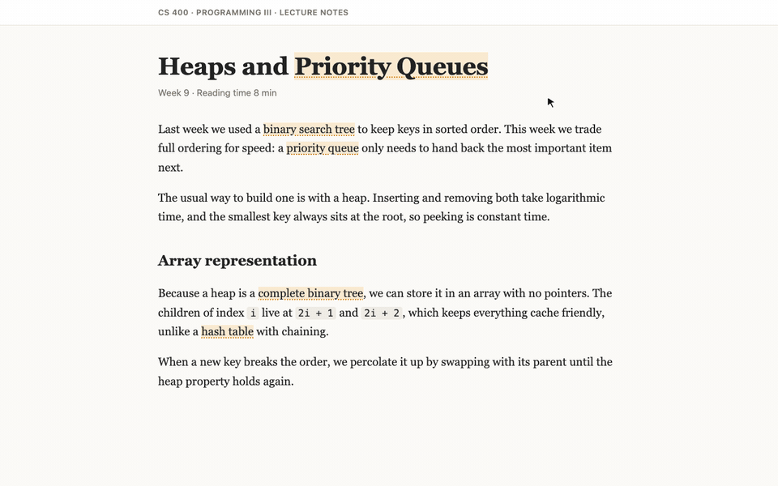
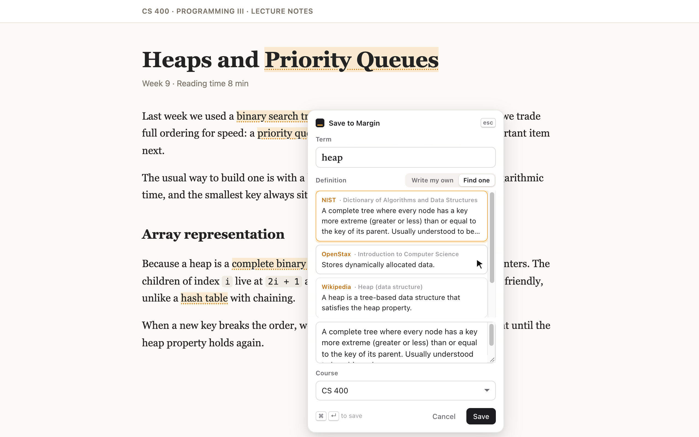
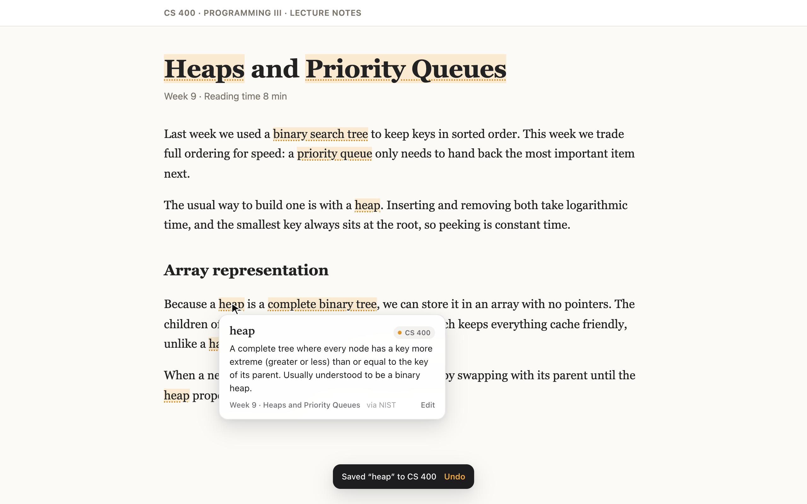
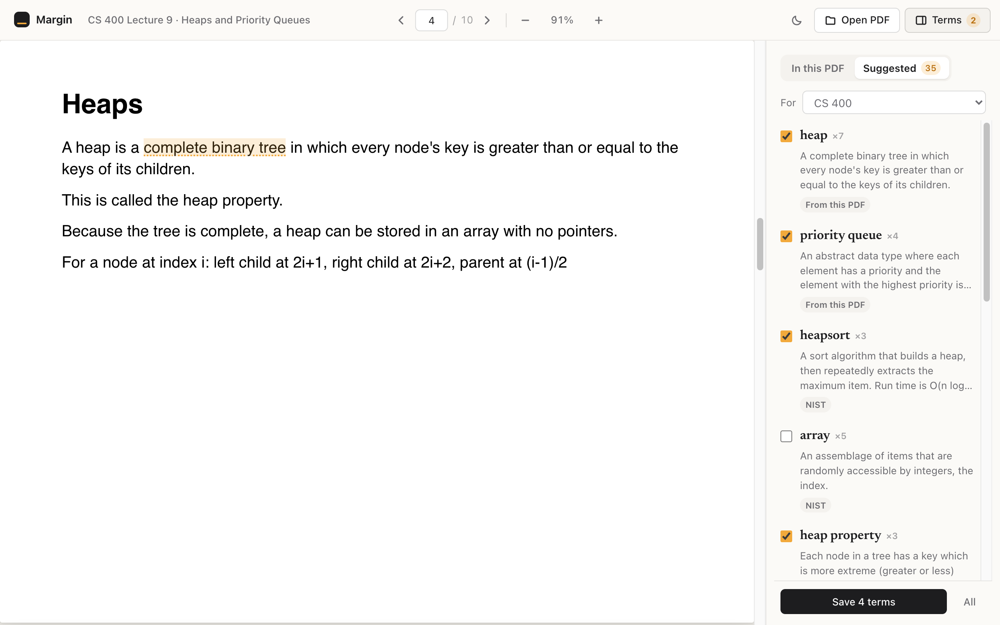
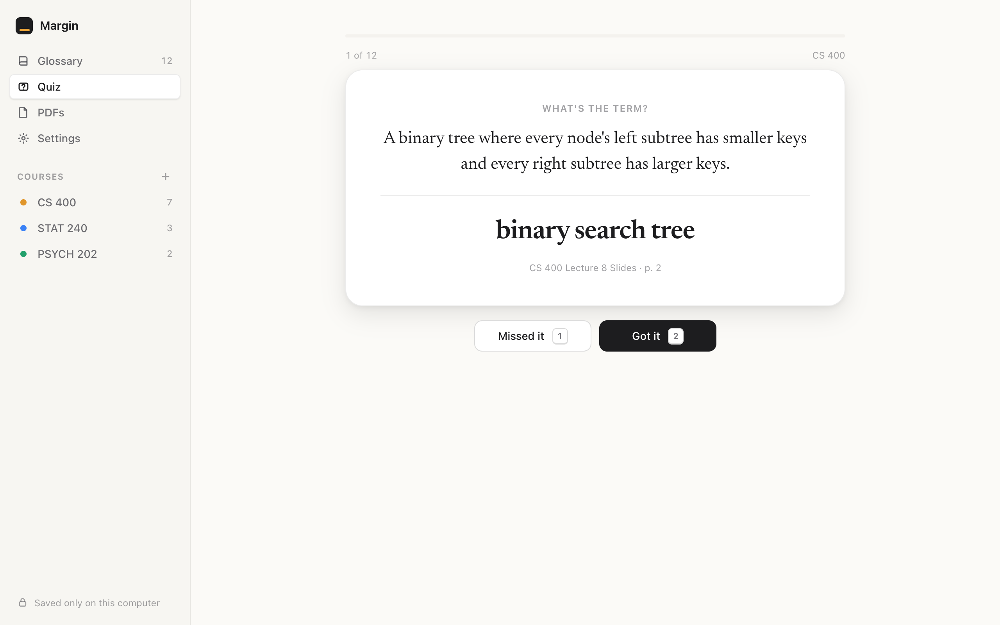
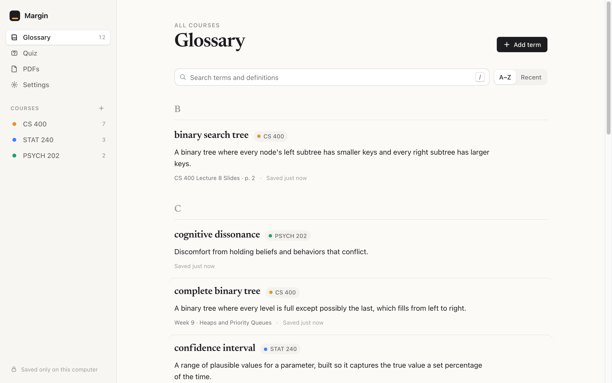
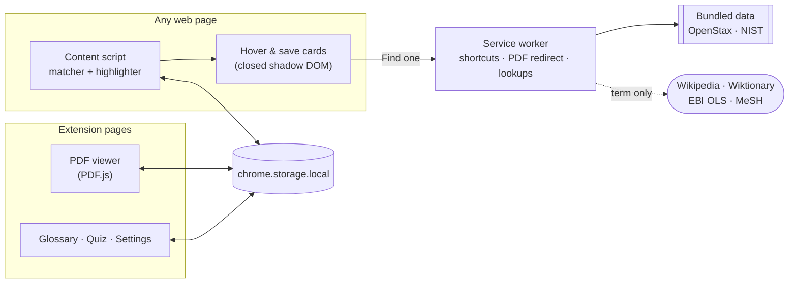

<div align="center">


# Margin

**Every term, in the margin.**<br>
A free Chrome extension that builds your course glossary while you study.<br>
Save a term once and see its definition on every page and lecture PDF.

[](https://github.com/prayush27/margin/actions/workflows/ci.yml)
[](LICENSE)


[Features](#features) · [Where definitions come from](#where-definitions-come-from) · [Privacy](#privacy) · [How it works](#how-it-works) · [Contributing](CONTRIBUTING.md)

<br>



</div>

## Why Margin

Every course has its own vocabulary, and it's scattered across slides, PDFs, Canvas pages and lecture notes. Margin lets you collect it where you read it: highlight a term, pick or write a definition, and from then on it's underlined everywhere it shows up, with your definition one hover away. At the end of the week your glossary is already built, and you can quiz yourself on it.

It's **free with no word limits**, keeps everything **on your computer**, and has **no account, no ads and no tracking**.

## Features

<table>
<tr>
<td width="50%" valign="top">

### Save a term in two seconds
Select text and press <kbd>⌥</kbd><kbd>⇧</kbd><kbd>S</kbd>, click the **Save term** pill, or right-click → **Save to Margin**. Then choose **Write my own**, or **Find one** to pick from definitions matched to your course.

</td>
<td width="50%" valign="top">

### Definitions everywhere you read
Saved terms get a soft amber underline on your course sites (Canvas, .edu pages, Gradescope, OpenStax, Wikipedia and other learning sites), including plurals, aliases (“BST” → binary search tree) and content that loads later. Hover for your definition, the course, and where you first saw it. Other sites stay untouched unless you turn Margin on for them, or choose **Everywhere** in Settings.

</td>
</tr>
<tr>
<td></td>
<td></td>
</tr>
<tr>
<td width="50%" valign="top">

### Built for lecture PDFs
Say yes once and lecture PDFs (from the web or your Mac) open in Margin's own PDF.js viewer, with underlines, hover cards, a **Terms in this PDF** panel with page links, and dark pages for late-night reading. The **Suggested** tab finds the lecture's key terms for you, with definitions from your professor's slides or the course's textbooks, ready to save in one click.

</td>
<td width="50%" valign="top">

### Glossary and quiz
Every term lives in a searchable glossary, organized by course. Quiz yourself from definition to term or term to definition. Terms you miss come back first.

</td>
</tr>
<tr>
<td></td>
<td></td>
</tr>
</table>

<p align="center">
<picture>
  <source media="(prefers-color-scheme: dark)" srcset=".github/media/glossary-dark.png">
  
</picture>
</p>

**Also:** light and dark mode everywhere · JSON and CSV export/import · per-course colors · source links back to the exact page of the PDF · undo right after saving · CSV export for Anki or Quizlet.

## Where definitions come from

**Find one** suggests definitions picked for your course's subject, read from its code (`CS 400`, `COMP SCI 577`, `STAT 240`, `PSYCH 202`, …) or name (“Intro to Psychology”).

| Source | Best for | How |
| --- | --- | --- |
| **Your glossary** | the same term in another course | on your computer |
| **The page itself** | sentences like “X is…”, “X refers to…”, “…is called X” | on your computer |
| **[OpenStax](https://openstax.org) textbook glossaries** | 24,000+ key terms from 64 free college textbooks: psychology, biology, chemistry, economics, statistics, nursing, physics, business… | bundled, offline |
| **[NIST Dictionary of Algorithms and Data Structures](https://xlinux.nist.gov/dads/)** | computer science | bundled, offline |
| **[EMBL-EBI ontologies](https://www.ebi.ac.uk/ols4/)** (STATO, Gene Ontology, Cell Ontology, Uberon, ChEBI, NCI Thesaurus, Mondo) | statistics, biology, chemistry, medicine | live |
| **[MeSH](https://www.nlm.nih.gov/mesh/)**, National Library of Medicine | biology, medicine, psychology | live |
| **Wikipedia** and **Wiktionary** | everything else, and plain-English meanings | live |

Every suggestion is labelled with its source and links back to it. Licenses and attribution are in [`data/SOURCES.md`](data/SOURCES.md).

## Install

Margin is coming soon to the **Chrome Web Store**, which will be the only official place to get it.

### Keyboard shortcuts

| Shortcut | Action |
| --- | --- |
| <kbd>⌥</kbd><kbd>⇧</kbd><kbd>S</kbd> (<kbd>Alt</kbd><kbd>Shift</kbd><kbd>S</kbd>) | Save the selected text as a term |
| <kbd>⌘</kbd><kbd>↵</kbd> | Save from the save card |
| <kbd>Esc</kbd> | Close the card |
| <kbd>/</kbd> | Search the glossary |
| <kbd>Space</kbd>, then <kbd>1</kbd> / <kbd>2</kbd> | Quiz: reveal, then *missed it* / *got it* |

Change the save shortcut at `chrome://extensions/shortcuts`.

## Privacy

Your glossary is stored only in your browser (`chrome.storage.local`). There's no account, server, analytics or remote code. The only network requests are **Find one** lookups, which send just the term to the public sources above, and only while that tab is open. Full details, including why each permission is needed, are in [PRIVACY.md](PRIVACY.md).

## How it works



A few details:

- **The page is never modified.** Underlines use the [CSS Custom Highlight API](https://developer.mozilla.org/docs/Web/API/CSS_Custom_Highlight_API), so Margin never wraps or rewrites a site's HTML. Cards live in a closed shadow root, so page styles can't leak in or out.
- **Fast matching.** The glossary compiles into two regular expressions (one case-sensitive, for acronyms like “OS”) that find every term, plural and alias in a single pass, longest match first. A `MutationObserver` catches content that loads later, and text boxes and editors are skipped.
- **PDFs are first-class.** A `webRequest` listener spots PDF responses and opens them in Margin's PDF.js viewer, where the same highlighter runs on the text layer.
- **Smart suggestions.** `lookup.js` maps course codes to subjects, queries the right sources in parallel with timeouts, ranks results by how well they fit the course, and caches answers.
- **Key-term finder.** `keyterms.js` scores every candidate in a lecture with four signals: matches in the course's textbook glossaries, definitions written on the slides ("A heap is…", "Load factor: …"), how rare the phrase is in everyday English ([wordfreq](https://github.com/rspeer/wordfreq) frequencies), and emphasis (repeats, pages, slide titles). Every suggested definition comes from the slides or a textbook, never generated text.
- **Zero dependencies, no build step.** Plain ES modules. Clone it, load it, edit it.

## Development

```sh
node tests/run.mjs        # unit tests: matcher, definition guesser, subject detection
node tools/check.mjs      # manifest references, imports and bundled data
./tools/package.sh        # dist/margin-<version>.zip
```

No Node? On macOS, `jsc -m tests/run.mjs` runs the tests with the built-in JavaScriptCore. See [CONTRIBUTING.md](CONTRIBUTING.md) for the project layout and guidelines.

## Roadmap

- [x] Hover definitions on any page, PDF viewer, glossary, quiz
- [x] **Find one**: subject-aware definitions from textbooks, field references and encyclopedias
- [x] **Suggested terms** in lecture PDFs: glossary matches, slide definitions and word-rarity scoring
- [ ] Lecture videos: catch terms in captions, with “explained at 34:12” timestamps
- [ ] Suggested terms on course web pages, not just PDFs
- [ ] Chrome Web Store release (the only official download)
- [ ] Firefox and Edge

Have an idea? [Open an issue](https://github.com/prayush27/margin/issues/new/choose).

## Credits

[PDF.js](https://mozilla.github.io/pdf.js/) (Apache 2.0) · [Newsreader](https://fonts.google.com/specimen/Newsreader) by Production Type (OFL) · definitions from [OpenStax](https://openstax.org), [NIST DADS](https://xlinux.nist.gov/dads/), [EMBL-EBI OLS](https://www.ebi.ac.uk/ols4/), [MeSH](https://www.nlm.nih.gov/mesh/), [Wikipedia](https://www.wikipedia.org) and [Wiktionary](https://www.wiktionary.org). OpenStax is a trademark of Rice University; Margin is not affiliated with or endorsed by any of these projects.

## License

[MIT](LICENSE) for Margin's code. Bundled fonts, PDF.js and definition data keep their own licenses, listed in [LICENSE](LICENSE) and [`data/SOURCES.md`](data/SOURCES.md).
